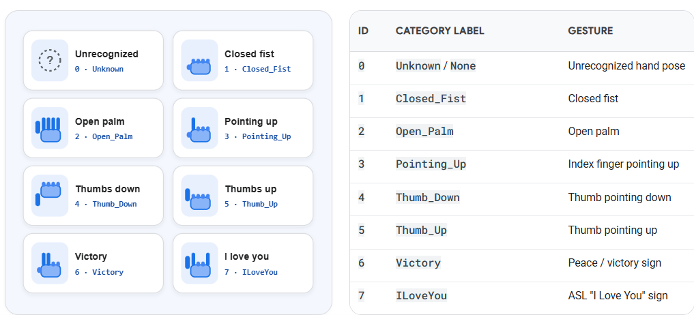
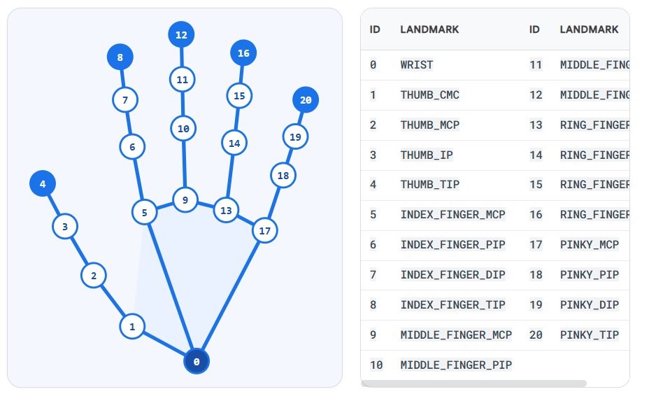

# IPM - Práctica Bloque 2 

### Autores:
#### Pablo Serna Soriano
#### Ismael Escribano Orts

---------------------------------------------------------

## Introducción

Para esta práctica hemos realizado un juego que consiste principalmente en realizar dibujos en pantalla mediante gestos con la mano para tratar de replicar lo mejor posible la figura indicada.

Nuestro juego pone a prueba la coordinación ojo-mano al igual que la visión espacial a la hora de realizar el dibujo.

El funcionamiento es muy simple, durante la partida se mostrará una silueta en la mitad inferior de la pantalla y el jugador deberá tratar de simularla en la mitad superior.
Durante el juego, el jugador tiene a su disposición diferentes gestos que puede utilizar y que se explican en un pequeño tutorial opcional al inicio de la partida.
Además, se pueden modificar algunos aspectos de la partida, como su duración entre otros, mediante un menú de configuración.

Para realizar la detección de estos gestos hemos utilizado el modelo *gesture recognizer* que detecta estos gestos simples:



En nuestro código contamos con varias funciones auxiliares que llamamos a lo largo del juego y un bucle principal que alterna entre distintos "estados" dependiendo del momento del juego. Como ejemplo de referencia, existe un estado "dibujando" y un estado "pausado".

A la hora de utilizar los índices de los puntos del landmarker solo hemos utilizado el del dedo índice para dibujar, ya que nos hemos centrado más en los gestos realizados con la mano. Aún así, para saber que índice debíamos utilizar acudimos a esta otra imagen:



## Prerequisitos

Tener instalado **Conda**, [instalar aquí](https://www.anaconda.com/docs/getting-started/miniconda/install).

## Requisitos

Crear un entorno de conda:
```bash
conda create -n IPM python=3.12
conda activate IPM
```

## Instalación

Instalar las dependencias necesarias de requirements.
```bash
pip install -r requirements.txt
```

## Descargar pesos

Script para poder descargar los pesos del modelo *Gesture Recognizer*:
```bash
python download_models.py
```

Si no descarga el modelo de esta manera se preguntará al usuario si lo quiere instalar al iniciar la app principal.


## Ejecución
```bash
python app_manos.py
```
La aplicación permite diferentes parametros:
- `-h` o `--help` $\rightarrow$ Muestra los parametros soportados
- `-r W H` o `--resolution W H` $\rightarrow$ Fuerza la resolución de la camara (si es posible) a "WxH"
- `-f N` o `--fps N` $\rightarrow$ Fuerza los FPS de la camara (si es posible) a "N"
- `-b N` o `--buffer N` $\rightarrow$ Fuerza el tamaño del buffer a "N"
- `--wsl` $\rightarrow$ Activa un ajuste preestablecido para el uso de una camara en WSL (Resolución 640x480 | FPS 30 | Buffer 2) 